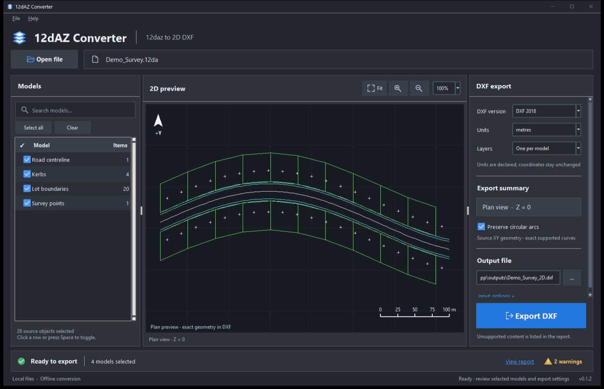
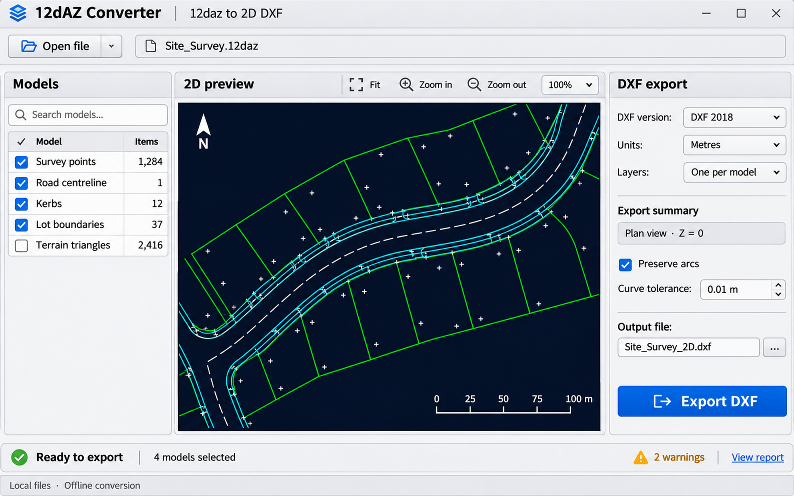

# 12dAZ Converter design

Status: design baseline with initial version 0.1.2 implemented, 14 November 2026. See [validation status](docs/validation_status.md) for actual evidence and outstanding release checks. Some options described below remain future scope.

## Implemented scope in version 0.1.2

The working implementation uses Tk/ttk, a spawned conversion worker and ezdxf. It exports supported base plan geometry to DXF 2018 with explicit user-selected units. Model selection, preview, overwrite checks, cancellation, reports and Help/About are implemented. Curve approximation, TIN edges, symbol mapping, automatic unit metadata resolution and drag-and-drop are deferred. See [validation status](docs/validation_status.md) for test/build evidence; sections below also describe intended future behaviour.

## Purpose and scope

Build a standalone, offline Windows desktop application that reads a `.12daz` file and writes an editable **2D DXF** drawing. Installation of 12d Model, AutoCAD or a Python runtime must not be required on the user's computer. Uncompressed `.12da` input is also supported through the same parser.

DWG is a future enhancement and introduces no dependency in the first release. The initial application is a converter with a preview, not a CAD editor. It exports model-space geometry; it does not recreate layouts, civil object intelligence or the complete 12d rendering system.

## Platform decision: Python versus Rust

Use **Python** for the first release, with Tk/ttk for the GUI and ezdxf for DXF creation. Implementation uses the standard Tk toolkit because PySide6 downloads were unavailable; the original generated mockup remains a visual reference. Package a Windows x64 application with its runtime and required libraries. Validate packaging early on a clean machine.

| Consideration | Python | Rust |
| --- | --- | --- |
| DXF implementation | ezdxf provides a documented entity-writing API | A crate or native adapter needs a separate capability evaluation |
| Parser development | Fast iteration against varied archive fixtures | More implementation effort, with strong compile-time checks |
| CPU and memory control | Requires streaming and careful object allocation | Strong option for intensive parsing and geometry processing |
| Desktop distribution | Bundle runtime and Qt dependencies | Native core still needs a GUI and its dependencies |
| Proposed role | Complete initial application | Optional future parser/geometry accelerator after profiling |

This is an engineering recommendation, not a measured performance comparison. Avoid maintaining two implementations initially. Keep parser and geometry interfaces separate so measured bottlenecks can later move to Rust without replacing the GUI or DXF writer.

The ezdxf documentation explicitly supports creating DXF documents and explicitly excludes native DWG conversion: [ezdxf introduction](https://ezdxf.readthedocs.io/en/stable/introduction.html).

## Available sample and format evidence

The private local sample is stored in the ignored `sample/` directory; its filename is omitted.

Initial inspection only, without a geometry parse:

- Compressed file size: 3,915,027 bytes.
- ZIP signature: `50 4B 03 04`.
- Contains one `.12da` entry; its filename is omitted.
- Declared uncompressed size: 88,923,538 bytes.
- Payload starts with a UTF-16 little-endian BOM and `null null`, followed by archive comments.

These observations validate this sample's container and encoding, not universal compatibility. Real model names, supported string types, counts, colours, units and export fidelity still require a parser and inspection. Numbers and geometry in the GUI image are illustrative.

Use the published archive grammar rather than inferring syntax solely from examples. The vendor documentation describes archive versions, commands, attributes and string types: [12d documentation](https://www.12d.com/learningtools/12d_Documentation.html) and [V15 archive specification](https://downloads.12dmodel.com/v15/12d_Model_15_C1e/12d_a_File_Format_V15_C1e.pdf). Autodesk also describes `.12daz` as zipped `.12da`: [12d extension release notes](https://up1.autodesk.com/2022/CIV3D/Autodesk_12d_Extension_2022_ReleaseNotes.htm).

## Startup and optional support in version 0.1.3

Normal desktop startup shows a brief dark grey splash that closes automatically after about 1.8 seconds. Continue, Enter and Escape skip it. CLI, worker and smoke-test paths do not show the startup screen. The splash and Help > About offer a voluntary Buy us a coffee (PayPal) button linking to https://paypal.me/12dazapp. The README includes the same link. Payment pages open in the browser only when clicked; the converter remains free, MIT licensed and does not process payments.

## Current implemented GUI

Version 0.1.2 keeps the proposal's three-panel layout and uses the requested dark grey theme with blue actions. The original concept below remains a reference. Unsupported settings, including curve tolerance, are not exposed as functioning controls.



The preview shares its 30,000-point allowance across selected models. Checkbox changes trigger a debounced background rebuild, with obsolete results discarded. Selecting one model makes the full allowance available to that model; full-geometry export remains independent of display sampling.

### Preview point selection

The initial preview selects points according to how they affect the visible drawing:

1. **Preserve path structure.** Keep the endpoints of open paths. For closed outlines, retain at least three distinct vertices and the closing edge when an outline can be shown. Preserve intentional gaps.
2. **Spend points on shape.** Rank candidate vertices by the deviation from the simplified path. Allocate more points to sharp bends and tight curves, using two endpoints for straight runs where possible. Use deterministic tie breaking.
3. **Spread coverage across the drawing.** When the budget cannot represent every path or standalone point, group features by spatial tile and distribute the allowance across occupied tiles. Give each selected model a share where the budget permits, then redistribute unused points from small models to those with remaining detail.

The collector compacts candidates in batches as geometry streams in and limits the displayed result to 30,000 points. It uses a spatial tile for each feature based on its first display point. Tests cover dense and sparse models, sharp bends, closed outlines, isolated features and independence from DXF export. The GUI labels simplified previews.

A later increment can refine detail for the visible area after zoom or pan, using the existing background refresh and stale-result handling. Keep the full selected extents available for Fit.

## Proposed GUI



The generated image proposes the layout and visual direction. Behaviour below is the implementation specification; image details are not evidence of implemented features.

Use a resizable three-pane desktop window, initially around 1440 x 900 pixels, with a practical minimum size and DPI-aware scaling. Light control panels surround a dark plan preview. Blue indicates the primary action, amber indicates warnings, and status messages always include text.

| Area | Controls and behaviour |
| --- | --- |
| Menu bar | Help: User Guide, About 12dAZ Converter, License and Third-party Notices |
| Top toolbar | Open file, current filename, replace input, application settings |
| Left: Models | Searchable list, entity counts, select all/none, model export checkboxes, colour indicators |
| Centre: 2D preview | Selected geometry, pan, zoom, fit extents, scale and coordinate readout |
| Right: DXF export | Output path, DXF version, units, layer policy, preserve arcs, approximation tolerance, Export DXF |
| Bottom | Current stage, progress, Cancel during work, warning count, View report, Open output folder after completion |

Model checkboxes control both export and preview in version one. Preview simplification is allowed for speed but must be labelled when active; it must not alter exported geometry. North means source +Y unless orientation information is known. Display a scale only when units are resolved.

### Help menu and copyright

Add a standard **Help** menu above the toolbar, accessible by mouse and keyboard:

- **User Guide**: open bundled offline instructions for opening files, selecting models, resolving units, exporting DXF and reading warnings.
- **About 12dAZ Converter**: open a dialog showing the application name, installed version/build, purpose (`12daz / 12da to 2D DXF`), MIT license identification and the copyright notice below.
- **License and Third-party Notices**: open the bundled full MIT license and dependency notices without requiring a network connection.

Display this notice in the About dialog as selectable, copyable text:

```text
Copyright (c) 2026 Lambda Technologies Pty Ltd ABN 22 647 165 160
```

Use the same notice in the bundled LICENSE. Keep Help available when no file is loaded and while a conversion runs. Opening help must not change conversion options or job state. The About dialog must have an accessible Close button and support Escape to dismiss. Allow notice text to wrap at smaller window sizes and high DPI without truncating the company name or ABN.

The existing GUI concept image predates this menu; the Help menu and About dialog specified here are required in the implemented GUI.

### User workflow and states

1. Open or drag in a `.12daz` or `.12da` file.
2. Validate the container and encoding, scan models and supported entity counts, then populate a plan preview.
3. Review selected models, skipped types and warnings. Resolve units if absent from the source.
4. Choose output path and conversion options. Export selected models into one DXF.
5. Display written, approximated and skipped counts, with a link to the report and output folder.

States: Empty, Loading, Ready, Exporting, Complete, Failed and Cancelled. Disable export while loading, with no selected convertible geometry, with unresolved required settings, or with an invalid output path. Show indeterminate progress when a reliable percentage is unavailable. Prompt before replacing an existing output file.

Changing input invalidates previous scan and preview state. Changing selection or export options invalidates the export summary. Completion with skipped source objects is visibly reported as completion with warnings. A structural parse error prevents publishing a misleading partial drawing.

## Architecture

```text
Tk/ttk GUI / command-line entry point
                  |
           Conversion service
                  |
Container reader -> Decoder -> Tokenizer/parser -> Source entities
                                                    |
                                       Selection and style mapping
                                                    |
                                         2D geometry conversion
                                           /                \
                                   Preview geometry      DXF writer
                                                            |
                                                 Validation and publish

Each stage emits progress, diagnostics and source references.
```

The GUI never parses input directly. Run conversion in a worker process, with progress and cancellation messages, to keep the UI responsive and permit reliable resource cleanup. Pass paths, settings and compact preview data between processes; avoid copying the complete geometry graph through IPC.

Suggested package structure:

```text
src/az12_converter/
  app.py             # GUI entry point
  cli.py             # automation entry point
  service.py         # job orchestration
  archive.py         # container and encoding handling
  parser/            # tokenizer, grammar and supported entity adapters
  geometry/          # source types, flattening and curve approximation
  export/dxf.py      # ezdxf backend
  preview/           # render-ready geometry and spatial filtering
  ui/                # Tk/ttk widgets and state
  diagnostics.py     # report schema and warning codes
tests/               # parser, geometry, export and integration fixtures
```

Core conversion code must not import GUI widgets. Pin tested dependencies in project metadata and a lockfile. Review Python, Tcl/Tk and dependency distribution obligations before release.

## Input and parser design

- Detect container bytes instead of trusting the extension. For version one, accept validated ZIP `.12daz` and plain `.12da`; explicitly reject other container types until supported by verified fixtures.
- Read archive members as streams. Do not extract arbitrary paths. Reject encrypted archives, corrupted members and ambiguous archives with multiple candidate `.12da` entries. Ignore unrelated non-payload entries with a diagnostic.
- Enforce configurable limits on member count, actual decompressed bytes, token length, nesting depth and entity count. Proposed initial expanded-input limit: 1 GiB, to be reviewed after benchmarking. Do not rely only on ZIP metadata.
- Honour a BOM for UTF-16 or UTF-8. Decode incrementally with strict error reporting. For legacy files without a BOM, use a validated default or an explicit encoding override; never silently replace undecodable characters.
- Tokenize quoted strings, comments, braces, numeric values and keywords according to the archive specification. Do not parse nested blocks with one regular expression.
- Record archive version, model context, style definitions, source entity identifier or ordinal, and line/offset information. Handle documented null values before validating coordinate values.
- Skip unknown balanced blocks only where the grammar establishes a safe boundary. Report unsupported semantic objects. Fail on malformed syntax where further parsing cannot be trusted.
- Use two passes over the payload where needed: scan definitions/model summaries first, then convert selected entities. This supports forward style references without retaining the full source document.

## Source and output data model

Keep source records independent of ezdxf: `SourceModel`, `SourceEntity`, `SourceStyle`, `Point3D`, `Segment`, `Arc`, `Text`, `Diagnostic`, and `ConversionOptions`. Complex source entities may produce several output entities. Preserve source identifiers in the report so approximation and omission are traceable.

The conversion report records source object counts separately from emitted CAD entity counts; splitting one object into many entities must not inflate the apparent number of converted source objects.

## 2D conversion rules

- Use source XY plan coordinates and set all output geometry to Z = 0, elevation = 0 and thickness = 0, with standard +Z extrusion where applicable.
- Preserve full survey coordinates by default. No automatic shift, rotation or CRS transformation. A temporary display origin may improve preview precision but must never leak into output coordinates.
- Use double precision and avoid rounding coordinates to display precision.
- Units must be obtained from trusted source metadata or explicitly chosen by the user. Declaring units sets drawing metadata; it does not rescale coordinates. Any unit conversion must be a separately labelled scale operation with a recorded factor.
- Preserve closure flags. Detect repeated vertices and degeneracy without inventing missing geometry. A vertical feature collapsing to a single XY location produces a diagnostic and, where meaningful, a point according to the documented entity policy.
- Retain exact XY circular arcs when the source definition permits it. A tilted 3D circle generally projects to an ellipse; do not flatten its centre and radius into a false circle.
- Approximate supported non-circular projected curves with polylines using a maximum XY chord-deviation tolerance. Default proposal: 0.01 metre converted to the selected units. Cap segment generation and report any cap that prevents meeting tolerance.
- Validate finite numbers, positive radii and valid curve definitions before output. Source Z values may appear in optional report metadata; they do not become drawing elevations.

### Geometry support plan

| Source geometry | 2D DXF output | Initial policy |
| --- | --- | --- |
| Point | POINT | Supported; configurable visible point style |
| Straight strings / 3D strings | LWPOLYLINE or LINE | Flatten XY, preserve ordering and closure |
| Circular arc / circle in XY plane | ARC, CIRCLE or polyline bulge | Preserve exact geometry |
| Text | TEXT; MTEXT where needed | Flatten insertion, preserve supported height/rotation/alignment; report font substitution |
| Super strings | LWPOLYLINE with bulges where valid | Implement only documented segment types; unsupported segments are reported |
| Non-circular curves / alignments | Approximated LWPOLYLINE | Later support within version one only after verified curve fixtures |
| TIN / mesh | Optional unique triangle edges as 2D LINE entities | Off by default; deduplicate shared source edges and warn about size |
| Symbols | Documented simple symbol mapping or POINT fallback | Report fallback; no invented block geometry |
| Pipes, drainage, complex civil objects | Only explicitly implemented plan representations | Unsupported types listed in report |

The release support matrix must name tested source variants. Loading a file successfully does not imply every object type is supported. Closed strings are boundaries unless fill export is explicitly implemented. Contour generation, paper-space layouts, external references and full civil semantics are outside the initial scope.

## Layers, styling and DXF

Default to one CAD layer per selected 12d model. Sanitize invalid characters and length, resolve case-insensitive collisions with stable suffixes, and record original-to-output names. Optional mapping rules can group models or use source attributes later.

Resolve colours and line styles from available definitions. Use layer defaults and per-entity overrides when needed to preserve differing colours within a model. Report unresolved styles and use documented fallbacks such as CONTINUOUS. Avoid external font or symbol dependencies where possible; report substitutions.

Use ezdxf to write DXF 2018 initially. Older DXF output versions are later compatibility options, not a reason to expose untested formats in the first release. Set units metadata when resolved, configure useful point display, save model-space entities and fit initial drawing extents. No layouts or title blocks are generated automatically.

Write to a temporary file beside the destination, reopen and audit it, and verify the supported entities' Z/elevation/thickness properties. Publish by atomic replacement only after validation and any overwrite confirmation. On failure or cancellation remove job-owned temporary files and preserve existing output. Reports use the same job identifier; disclose a report-save failure separately from DXF success.

## Diagnostics and command line

Write a readable summary and a JSON report containing input hash, application version, archive version, options, model/layer mappings, units, bounding boxes, source counts, output counts, approximations, skips, elapsed time and diagnostics with source references. Bound verbose warning samples while retaining aggregate counts. Keep all processing local.

Proposed CLI contract, not yet implemented:

```powershell
12daz-converter convert "survey.12daz" --output "survey_2D.dxf" --units metres
12daz-converter inspect "survey.12daz" --report "survey-inspect.json"
```

Exit codes: 0 = completed without loss warnings; 2 = completed with reported approximations, substitutions or skips; 1 = failed; 3 = cancelled. Explicit overwrite is required in unattended mode. Share the same conversion service and defaults with the GUI.

## Performance and verification

Streaming input is mandatory, but ezdxf can still retain a large drawing in memory. Measure peak memory across parsing, preview and DXF writing before claiming large-file support. Keep the preview bounded by spatial filtering and drawing simplification. Never discard export geometry to satisfy a preview limit.

Use the available 89 MB expanded sample as the first realistic benchmark. Record machine specifications, elapsed time, source/output counts, peak memory and cancellation latency. Provisional goals on a documented reference Windows x64 machine: UI remains responsive, cancel acknowledged within two seconds, and the sample exports within two minutes under 2 GiB peak memory. These are targets, not measured results; revise after the first benchmark.

The detailed [test requirements and cases](docs/test_requirements.md) define traceable acceptance criteria, fixtures, tolerances and release gates. Executable tests now cover a subset of these cases; [validation status](docs/validation_status.md) distinguishes automated coverage from pending manual qualification.

Required validation before release:

- Archive/encoding fixtures: current UTF-16 ZIP sample, plain input, UTF-8, corrupt ZIP, ambiguous members, malformed nesting and decompression limits.
- Geometry fixtures: large survey coordinates, closure, clockwise/counterclockwise arcs, bulges, null Z, tilted circles, zero-length segments, text alignment and unit handling.
- Verify arc endpoints and tessellation error against analytic reference geometry, not only serialized output snapshots.
- Reopen DXF and verify entity counts, layer mapping, XY bounds and all supported Z-bearing properties; independently open representative drawings in a CAD application and compare against known reference exports.
- Test Windows installation and launch without Python, 12d Model or AutoCAD; exercise Unicode paths, existing output, cancellation and disk-write failure.
- Account for every selected source object as exported, approximated or skipped. Fatal parse errors must not publish a successful output.

## Delivery stages

Follow [implementation steps](docs/implementation_steps.md) for ordered tasks, deliverables and completion criteria for each stage.

1. Format spike: inventory sample types and definitions, validate grammar/encoding, produce scan report and benchmark baseline.
2. CLI conversion: point, line, polyline, exact arc and basic text output; layer mapping, diagnostics and output validation.
3. GUI: implement the proposed layout, model selection, bounded plan preview and worker cancellation.
4. Release: expand fixture coverage for required real-world types, verify CAD interoperability and standalone packaging.

A first release is complete when the supported sample geometry converts correctly, unsupported content is clearly reported, the output is genuinely 2D, and the packaged program works offline on a clean Windows machine.

## Future enhancements

- **Optional source-Z preservation:** feasible as a staged enhancement; see the assessment below. The implemented default remains flattened 2D DXF.
- **DWG output:** introduce a separate writer/conversion adapter after DXF reliability is established. Evaluate ODA Drawings SDK or a supported converter and review redistribution terms. Do not rename a DXF file to `.dwg`. [ODA Drawings SDK](https://www.opendesign.com/products/drawings), [ODA File Converter](https://www.opendesign.com/GUESTFILES/ODA_FILE_CONVERTER).
- Batch conversion, saved model/layer presets and additional DXF versions.
- Expanded alignment, symbol and style support; optional contour generation.
- Rust acceleration only where benchmarks justify the integration and maintenance cost.

## Feasibility: optional Keep Z / 3D DXF export

Assessment date: 15 November 2026. **Feasible for supported geometry, with moderate cross-cutting implementation work.** The current Python/Tk/ezdxf architecture can support an explicit elevation-preserving mode without a new repository or CAD installation. This is a proposal, not an implemented feature or a promise of full 3D 12d compatibility. Arbitrary spatial curves and vertical alignment reconstruction need additional format research and qualification.

### Current behaviour and where Z is lost

- `src/az12_converter/geometry.py`: `Primitive.points` holds XY pairs. Vertex conversion checks non-null Z values but discards them. Standalone circles/arcs and text are also reduced to XY. Closure, duplicate detection and collapse-to-point decisions currently compare XY only, so a vertical line can collapse to a point.
- `src/az12_converter/export/dxf.py`: `DxfWriter` writes points, circle centres and text placement at Z = 0 and uses planar `LWPOLYLINE` entities for strings. `validate_dxf` deliberately rejects nonzero output Z/elevation and nonstandard extrusion.
- `src/az12_converter/service.py`: `Options` has no dimensional mode. Inspect, geometry conversion, reports and export validation must share the chosen mode. `worker.py` already transports options as a dictionary, so the process architecture can remain.
- Super-alignments currently use solved horizontal geometry and explicitly omit vertical design. Keeping Z on ordinary strings cannot recover an omitted alignment profile or source metadata.

Changing only the writer would be insufficient: the source elevations have already been discarded before writing.

### Proposed user controls

Add an **Output geometry** selector in the DXF export panel:

- **2D — flatten Z to zero**: existing behaviour and default.
- **3D — keep source Z**: preserve known source XYZ for the geometry supported by this mode.

Use an explicit CLI option, proposed as `--geometry-mode flatten-2d|keep-z`, with `flatten-2d` as the default. Choose a default `_3D.dxf` filename in Keep Z mode and `_2D.dxf` in flatten mode without silently replacing a user-chosen destination. Display the selected mode in export summaries and conversion reports.

The initial preview can remain an XY plan projection, labelled **Plan preview — source Z retained in export** in Keep Z mode. It must not claim to be an interactive 3D viewer. Display model Z ranges and missing-Z counts; mode changes must invalidate cached preview/export results and rebuild mode-dependent eligibility and diagnostics through the worker.

### DXF entity strategy

| Source case | Proposed Keep Z representation | Boundary or risk |
| --- | --- | --- |
| Point with known XYZ | DXF `POINT` at original XYZ | Preserve vertically stacked points with identical XY. |
| Straight string with changing Z | DXF 3D `POLYLINE` with XYZ vertices, or `LINE` for deliberately split segments | Preserve closure and colour splitting; compare XYZ for duplicate/collapse checks. |
| Horizontal string at one known elevation, including circular segments | `LWPOLYLINE` with XY/bulges and its constant elevation | A planar lightweight polyline cannot hold a different Z for each vertex. |
| Horizontal circle or arc with verified constant Z | `CIRCLE`/`ARC` with elevation, or elevated bulged polyline | Check centre/end Z consistency and preserve sweep/direction. |
| Supported basic horizontal text | `TEXT` with source Z at insertion/alignment points | Existing font/placement restrictions remain; no implied support for tilted or offset text. |
| Circular plan segment whose endpoint elevations differ | Sample to a 3D polyline when the user enables the linear-grade assumption. Otherwise report a skip. | Use the source XY arc and known endpoint elevations. Sample to the requested plan tolerance. |
| Tilted planar circle/arc | Defer until plane/orientation data is parsed and verified | Requires correct object coordinate system (OCS), normal and world coordinate system (WCS) transforms. |
| Super-alignment requiring a vertical profile | Defer or skip in Keep Z mode unless verified source elevations are available | Do not label horizontal-only geometry as preserved 3D. |
| TIN, mesh, drainage and other currently unsupported objects | Remain unsupported | Keeping Z is an elevation-preservation feature, not solid/surface or civil-model reconstruction. |

This entity strategy is an engineering proposal based on the current converter and ezdxf capabilities. The library documents [planar LWPOLYLINE and its elevation](https://ezdxf.readthedocs.io/en/stable/tutorials/lwpolyline.html), [3D polyline creation](https://ezdxf.readthedocs.io/en/stable/dxfentities/polyline.html), and [OCS/WCS handling for oriented entities](https://ezdxf.readthedocs.io/en/stable/tutorials/ocs_usage.html). The linked stable documentation may describe a newer library release; verify APIs against the pinned 1.3.5 dependency before implementation.

**Rising curves need a separate policy.** A circular XY path with varying Z need not be a planar circular arc in 3D. Equal endpoint elevations alone do not prove a constant elevation along a segment if source vertical controls exist. Do not silently flatten it, replace it with one chord, or invent a vertical profile. A later, explicitly enabled approximation may sample XY curves with a verified Z law and stated horizontal/vertical tolerances, recording the approximation and entity counts. Straight interpolation of Z is acceptable only when supported by the source definition or explicitly disclosed as an assumption; it must not be called exact preservation.

### Missing elevations and numeric rules

Preserve known XYZ without rescaling or changing the vertical datum. Retain null/missing elevations distinctly from numeric zero and from the archive's configured null sentinel. Validate the grammar for object-level elevations and genuinely 2D source objects before assigning any default Z.

For the initial Keep Z mode, skip a whole object with unresolved required elevations and a clear diagnostic, rather than inventing zero or joining across missing vertices. Any future fallback-to-zero or interpolation must be an explicit option with warnings and report counts. Reject malformed/non-finite coordinates. Use documented coordinate tolerances for coplanarity and duplicate checks without rounding or snapping valid source elevations. Distinct XYZ points at the same XY must remain distinct, including vertical segments and closing edges.

### Implementation stages and effort

1. **Retain source XYZ.** Extend the internal geometry representation, preserve missing-Z state and source elevation provenance, and keep XY curve calculations separate from spatial coordinates. Audit every constructor and per-segment colour split so none loses Z. Cover closure, degeneracy, negative elevations and stacked points.
2. **Add the bounded Keep Z writer.** Support known-Z points, straight 3D strings and verified horizontal constant-elevation curves/basic text. Introduce the shared geometry-mode option and explicit unsupported/missing-Z policies. Preserve the existing 2D path.
3. **Integrate GUI, CLI and reports.** Carry the mode through inspect/preview/export and worker options. Update preview labels, default filenames, offline help and packaged-app smoke checks. Report chosen mode, XYZ bounds, missing-Z objects, approximation policy and skips, with source references.
4. **Validate by mode.** Retain strict zero-Z checks for flattened output. For Keep Z, reopen and inspect entity-specific WCS positions, including every 3D polyline vertex, elevated lightweight polyline vertices and text alignment points; verify expected XYZ against source-derived evidence and geometry tolerances. An audit or nonzero Z alone does not prove fidelity. Keep atomic publication, overwrite protection and cancellation guarantees.
5. **Qualify and then expand.** Independently compare representative files in CAD before claiming production-ready 3D support. Research rising/tilted curves and vertical alignments separately; add them only with verified source semantics and dedicated tests.

Relative effort: straight known-Z points/strings and horizontal elevated entities are the practical first increment; null-Z handling and mode-aware validation are essential parts of it. Rising curves, tilted geometry and vertical alignments are substantially more complex. No delivery-duration estimate is established by this assessment.

### Required acceptance evidence

- Existing flatten-mode geometry checks still pass: unchanged supported XY geometry, exact supported plan arcs and all exported Z values zero.
- Keep Z fixtures cover positive/negative/zero elevations, large survey coordinates, per-vertex Z, same-XY/different-Z points, vertical lines, closed strings, segment colours, missing/null Z and non-finite rejection.
- Constant-elevation circles and bulged strings preserve elevation, radius, direction and endpoints. Differing-Z curves and unqualified alignments are explicitly reported and skipped under the initial policy.
- Round-trip DXF assertions inspect WCS geometry, 3D vertices and text placement, not just entity counts or audit success. Include units-without-rescaling, worker mode changes, cancellation, overwrite and packaged GUI/CLI cases.
- Independent CAD inspection confirms elevations, connectivity and curve representation against known reference geometry. Document memory/output-size impact before introducing curve sampling.

### Feasibility spike performed

A temporary writer-only check using the installed **ezdxf 1.3.5** created and reopened an R2018 DXF containing an XYZ point, a varying-Z 3D polyline, an elevated bulged lightweight polyline, a circle and text at nonzero Z. Their expected coordinates/elevation/bulge survived round-trip, and the audit reported no errors or fixes. The temporary file was removed when the check completed.

This establishes availability of the basic writer APIs in the pinned dependency. It does **not** test a Keep Z converter path, source-Z interpretation, rising curves, CAD interoperability or clean-machine distribution. No application or website behaviour changes as part of this feasibility documentation.

## Planned expanded string and non-circular geometry support

This is a proposed implementation scope, not a statement of current support. Extend conversion to **2D, 3D and 4D strings, super strings, polylines, contours, pipes and super alignments**. Alignments defined by intersection points must be reconstructed and sampled through their circular arcs, transition spirals and parabolic vertical curves so the DXF follows the design geometry within an explicit approximation tolerance. Do not replace an unsupported curve with a straight chord or treat intersection points as the finished alignment.

### Source interpretation and output policy

| Source object | Planned conversion |
| --- | --- |
| 2D strings and polylines | Preserve vertices, ordering, breaks and closure; evaluate any supported curved segments before export. |
| 3D strings | Preserve source XYZ in Keep Z mode; export the corresponding plan geometry in Flatten 2D mode. |
| 4D strings | Verify the source record layout and meaning of the fourth component against documented fixtures. Preserve XYZ where defined and record the additional component as metadata where a verified mapping exists; do not reinterpret it as another spatial axis. |
| Super strings | Support mixed straight, circular and verified non-circular segments, including segment attributes and colours. Preserve exact circular representations where valid; sample other supported curves. |
| Contours | Export existing contour strings with closure and elevation preserved in Keep Z mode, or flattened in 2D mode. Generating contours from a TIN remains separate work. |
| Pipes | Export verified pipe centreline geometry and source elevations where available. Report omitted diameter, connectivity and other civil attributes; pipe solids and network reconstruction are outside this increment. |
| Super alignments | Support both solved geometry and verified intersection-point definitions. Reconstruct horizontal straights, arcs and transition spirals together with the vertical profile, including parabolic vertical curves. |

Source variants and parameters must be researched and qualified with fixtures before enabling each type. Do not assume every transition is a clothoid or every vertical curve uses the same parameter convention. Resolve curve direction, chainage, units, tangent constraints and profile conventions from verified source semantics. If solved and intersection-point definitions coexist, establish and document their precedence and check them for inconsistencies.

### Alignment evaluation and sampling

1. Build a shared evaluator that returns plan position and, where known, elevation at a source chainage. Reconstruct the horizontal alignment from intersection points and its curve parameters, rather than joining the intersection points directly.
2. Evaluate straight, circular and verified spiral segments using their actual definitions. Evaluate parabolic vertical curves over their defined chainage intervals and combine the resulting elevation with the horizontal position at the same chainage. Retain ordinary source vertices and explicit discontinuities.
3. Sample adaptively using a user-selected maximum deviation in the selected drawing units. Define separate plan and elevation error checks for Keep Z mode; a flat plan segment can still need intermediate points to represent its vertical curve. Subdivision acceptance must use a curve-specific error bound or a verified conservative method, rather than relying only on a midpoint check.
4. Include segment endpoints, horizontal and vertical curve boundaries, and required geometric extrema. Preserve continuity where the source specifies it, closure, direction and chainage order. Split at intentional gaps; never connect across missing geometry.
5. Write sampled planar geometry as LWPOLYLINE and varying-elevation geometry as 3D POLYLINE. Preserve exact circles/arcs and valid constant-elevation bulges when the chosen output representation permits them. Flatten 2D evaluates horizontal geometry only and explicitly reports omitted vertical information; Keep Z requires verified elevations.

Approximation must have finite subdivision, vertex and cancellation limits. If the requested accuracy cannot be achieved within those limits, skip the whole source object with a diagnostic; do not silently relax tolerance or publish a partial alignment. Missing required parameters, unsupported curve families, inconsistent definitions and unresolved Keep Z elevations also skip the whole object with a specific reason. Existing whole-object skip behaviour remains until each evaluator is qualified.

### Delivery, reporting and acceptance

Implement in stages: first qualify source layouts and add a segment/profile representation; next add curve evaluators and tolerance-controlled sampling; then integrate the DXF writer, preview, GUI/CLI options and conversion reports. Enable support per verified source variant. Preview may simplify the evaluated result separately, while export must meet the selected tolerance.

Expose curve tolerance only when approximation is implemented. Reports must identify source type, exact versus sampled output, output dimensional mode, requested tolerance, validated error bound or estimate and its method, generated vertex counts, omitted attributes and skip reasons. Distinguish an estimated error from a proven bound. Account for each selected source object as exported exactly, approximated or skipped.

Acceptance fixtures must cover all listed string families, mixed straight/arc/spiral super strings, contour closure/elevation, pipe centreline elevations, and intersection-point alignments with horizontal transitions and parabolic vertical curves. Check positions at independent reference chainages, endpoints, tangent continuity where specified, vertical grades, curve extrema and approximation error against analytical or independently generated reference geometry. Include reversed direction, large coordinates, unit changes, short/degenerate segments, missing parameters, malformed fourth components, missing elevations and sampling-limit failures. Reopen DXF output to verify XY/XYZ vertices, closure and entity types; independently inspect representative drawings in CAD. Verify that Flatten 2D produces zero Z and that Keep Z preserves the evaluated profile within tolerance.

### Implementation steps

**Circular strings with varying elevations.** In Keep Z, enable **Assume linear grade on arcs** or pass `--linear-arc-elevations` to sample supported circular segments with differing endpoint elevations. The option defaults to off. The evaluator follows the signed XY arc and interpolates Z by distance along it. This assumption supplies a linear profile, so the elevation tolerance used for solved alignment profiles does not govern these arcs. The plan tolerance bounds the XY chord deviation using the arc radius and angular step.

Keep the source XYZ endpoints, segment colours and closing edge. Store sampled arcs in 3D polylines and retain level arcs as exact bulges in separate planar runs where needed. Cap the number of added vertices per object and check cancellation during sampling. Missing required elevations or a tolerance that exceeds the sampling budget cause a reported whole-object skip. Report the assumed grade, plan tolerance and added vertex count for sampled objects.

4D strings and existing contours are deferred until genuine source records are available. Keep Z can sample solved horizontal lines and circular arcs against solved vertical grades and symmetric parabolas. Plan and elevation tolerances default to 0.01 drawing units and can be set separately in the GUI or using `--plan-tolerance` and `--elevation-tolerance`. The six local archives yielded 91 convertible alignments on inspection.

The local `spiral` blocks are zero-length defaults. Active compound transitions refer to other geometry or appear within mixed part sequences, and their exported solved plans use line and circular arc segments. Conversion reports when it uses a solved plan for an active transition. Tolerance applies to sampling that solved representation. Qualifying an original spiral evaluator still requires a nonzero definition with enough geometric constraints and an independent reference.

For straight alignments explicitly marked horizontally valid and IP-only, the converter checks the IP sequence and closure against the solved plan when present. If solved vertices are absent, it reconstructs the plan from the IP records. All 17 straight IP examples in the local archives matched their solved vertices exactly, including four closed plans.

For valid open alignments with a fixed line, a free-radius arc and a second fixed line, the converter can reconstruct the minor tangent arc when solved vertices are absent. It honours signed radii, fixed-line offsets and hidden tangent lines. The reconstruction matched the solved vertices and bulges of all six examples of this layout within 0.000001 drawing units for positions and 0.000001 for bulges. Other curved layouts and spiral evaluation remain pending.

Flatten 2D exports solved drainage pipe spans as one polyline per consecutive pit pair, including intermediate plan vertices. The converter checks the pit indices, pipe count and pit XY against the solved drainage vertices before exporting. Reports identify the omitted elevations, dimensions, pit structures and hydraulic attributes. Keep Z remains pending verification of the pipe centreline elevation convention.

The GUI Geometry selector and CLI `--geometry-mode keep-z` support elevation preservation for qualified straight strings, points, basic text and constant-elevation circular geometry with explicit source elevations. Flatten 2D remains the default and the GUI preview shows the source plan in either mode. A DXF round-trip test checks the exported elevations. The synthetic fixture documents the expanded source layouts that need verification against a 12d Model export.

The following steps are planned work. Complete them in dependency order; qualify and enable individual source variants incrementally rather than advertising the entire scope after the first parser change. Acceptance IDs refer to [test requirements](docs/test_requirements.md).

1. **Establish source fixtures and conventions.** Inventory the current unsupported types and collect permitted, minimal examples for every proposed string family and alignment definition. Document record layouts, null values, fourth-component semantics, pipe elevation conventions, spiral parameters, vertical-curve definitions and solved-versus-intersection-point precedence. Create independent expected chainage/XYZ results and fixture manifests before implementing evaluators. Deliverable: a source-variant support matrix and F-EXPANDED fixtures supporting EG-01 to EG-09; unverified variants remain disabled.

2. **Introduce a dimensional segment/profile model.** Extend the representation currently in `src/az12_converter/geometry.py` to retain XYZ, missing-elevation state, source references, chainage intervals, breaks, closure and segment styling. Represent horizontal straight/arc/spiral segments and vertical grade/parabola intervals separately, with fourth-component metadata where verified. Keep exact and sampled primitives distinguishable. Integrate the proposed Keep Z foundation before enabling elevated output. Deliverable: mode-aware geometry contracts with EG-01, EG-02 and EG-07 coverage, retaining the existing flattened-output checks.

3. **Parse and normalize expanded objects.** Extend `parser.py` and geometry normalization for qualified 2D/3D/4D strings, super strings, polylines, existing contours and pipe centrelines. Retain sufficient source data for later evaluation instead of flattening during parsing. Validate dimensionality, finite coordinates, required fields and intentional gaps; apply verified pipe elevation semantics and record omitted civil attributes. Deliverable: source-to-normalized-object checks for EG-01 to EG-04 and rejection fixtures from EG-09.

4. **Reconstruct horizontal alignments.** Add testable horizontal evaluators, in focused modules if needed, for solved geometry and intersection-point definitions. Resolve tangent points, arc centres/directions, transition lengths, chainage origins and source-defined chainage discontinuities. Implement only verified spiral families. Check consistency when multiple definitions coexist and expose position/tangent evaluation at chainage. Deliverable: independent analytic/reference checks passing EG-05 and EG-06, including reversed direction and degenerate inputs.

5. **Evaluate and combine vertical profiles.** Implement source-defined grade intervals and parabolic vertical curves, including crest/sag extrema and profile boundaries. Combine elevation and plan position at the same source chainage, preserving missing-profile state. Flatten 2D must still work from valid horizontal data when vertical data is unsupported, with an omission diagnostic; Keep Z must skip objects requiring unresolved elevations. Deliverable: independently verified positions and grades for EG-07 and missing/inconsistent-profile cases in EG-09.

6. **Implement bounded adaptive sampling.** Add separate plan/elevation tolerances in drawing units and curve-specific conservative error checks. Partition at horizontal/vertical boundaries, extrema, gaps and source discontinuities before subdivision. Preserve exact representations where valid. Enforce finite subdivision and per-object/job vertex limits, check cancellation during evaluation, and stage each object's result until its complete geometry passes. Deliverable: EG-08 and EG-10 pass without silent tolerance relaxation or partial-object emission.

7. **Integrate DXF output and validation.** Extend `export/dxf.py` for planar sampled LWPOLYLINE, varying-Z 3D POLYLINE and eligible exact elevated entities. Preserve segment styling when splitting entities and retain one source-object accounting record. Make pre-publication validation mode-aware: zero Z for Flatten 2D, independently expected XYZ/profile checks for Keep Z, and correct closure/entity types for both. Deliverable: EG-11, applicable GE/DX regression cases and atomic publication/cancellation checks pass.

8. **Connect options, preview and reports.** Carry geometry mode, tolerances and sampling limits through `service.py`, `worker.py`, `cli.py` and `app.py`; expose only implemented choices and validate them before conversion. Update `preview.py` to consume evaluated geometry with separately labelled display simplification. Invalidate stale previews and summaries when settings change. Record exact/approximated/skipped source counts, sampling method/error evidence, generated vertices and omitted attributes in reports. Deliverable: EG-12, GUI/CLI parity and report reconciliation pass.

9. **Qualify and release each supported variant.** Run applicable EG-01 to EG-12 cases, existing regression checks, sampling performance/cancellation checks, independent CAD inspection and packaged offline smoke checks. Update `docs/validation_status.md`, the tested support matrix and bundled user guide with measured results and limitations. Enable a variant only after its parser, evaluator, writer and selected dimensional mode pass their acceptance cases; retain explicit skips for remaining variants.

## GUI concept provenance

Generated using the built-in image generation tool with the imagegen skill. Image: `docs/assets/12daz-converter-gui-proposal.png`. The exact generation prompt is saved in `docs/assets/12daz-converter-gui-prompt.txt`. The image depicts sample values and a proposed interface, not running software.
