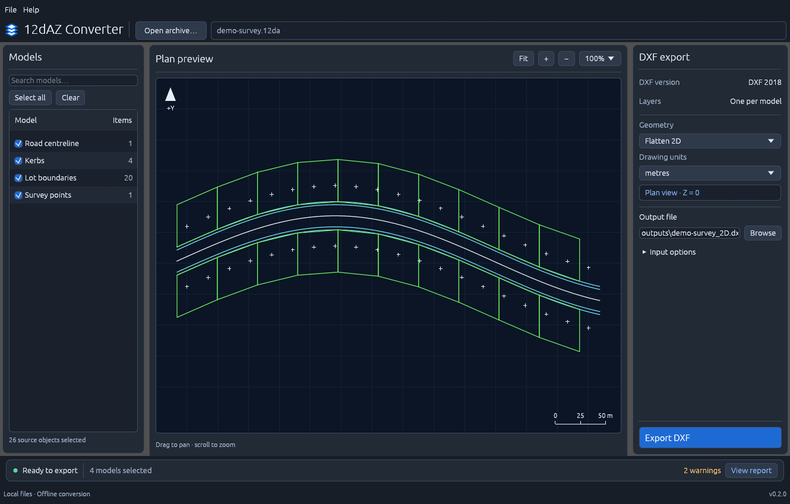

# 12dAZ Converter

Offline Windows desktop converter from **12daz / 12da to editable DXF 2018**. Export in **Flatten 2D** mode to set Z to zero, or choose **Keep Z** to retain known source elevations on supported geometry. The converter writes one layer per model and runs without 12d Model or AutoCAD installed.

**v0.3.0** adds background maps to the desktop plan preview. Use **View → Background Map** for OpenStreetMap Streets, Google Satellite with Labels, or Esri World Imagery with Labels. Assign the survey datum, MGA zone and source units, or align a local grid using control points. Google and Esri require your own API key. The Windows ZIP includes the desktop app and command-line converter. Clean-machine verification is tracked separately. [Download v0.3.0](https://github.com/Ala-Ismail/12daz-App/releases/tag/v0.3.0) · [Rust validation results](docs/rust_migration_validation.md)



*Screenshot uses synthetic demonstration data.*

## Code signing status and Windows warning

The published v0.3.0 Windows package is unsigned. Windows may display an **Unknown publisher** notice or a Microsoft Defender SmartScreen warning. The project is preparing optional publisher signing. [Code signing policy](docs/code_signing_policy.md)

Use the project's official releases for published downloads. Verify the ZIP against its published `SHA256SUMS.txt` to check download integrity. [GitHub Releases](https://github.com/Ala-Ismail/12daz-App/releases)

## Run the Windows application

Extract the complete Windows x64 ZIP and run `12dAZ-Converter.exe` from the extracted folder. The desktop requires an OpenGL 2.0 or newer graphics driver. Keep the files in that folder together. The ZIP includes `az12-converter.exe` for command-line use.

1. Open a `.12daz` or `.12da` file.
2. Review the preview and select the models to export.
3. Choose drawing units, **Flatten 2D** or **Keep Z** under **Geometry**, and a `.dxf` destination. Declaring units does not rescale coordinates. The preview shows the source plan in either mode.
4. Select **Export DXF** and review warnings in **Report**. A `.dxf.conversion.json` report is saved beside the drawing.

**Help** provides the offline User Guide, About, license, and dependency notices. Cancel requests safe cleanup before output publication.

## Run from source

Use the Rust 1.99.1 toolchain with the Windows MSVC build tools and Windows SDK. Run these commands from the repository root.

```powershell
cargo run --manifest-path rust/Cargo.toml --locked --features desktop --bin 12dAZ-Converter
```

The desktop uses `eframe`/`egui`. It runs conversion on a background worker using the same Rust service as the CLI. The core uses `acadrust` to write and reopen DXF 2018. Python's `ezdxf` remains an independent audit reader in migration tests.

**Future features and enhancements are Rust-only.** Implement them in `rust/` and add coverage to the Rust test suite. The Python source serves as the historical parity reference and supports builds from earlier release tags.

Run the CLI from the portable folder in PowerShell.

```powershell
.\az12-converter.exe inspect "survey.12daz" --report "inspect.json"
.\az12-converter.exe convert "survey.12daz" --output "survey_2D.dxf" --units metres
.\az12-converter.exe convert "survey.12daz" --output "survey_3D.dxf" --units metres --geometry-mode keep-z
```

From source, use `cargo run --manifest-path rust/Cargo.toml --locked --bin az12-converter --` followed by the CLI arguments. Repeat `--model "Model name"` to select models. Use `--overwrite` to replace existing drawing and report files, `--encoding cp1252` for a legacy file without a BOM, or `--max-expanded-mib` to change the 1024 MiB limit. Exit codes are `0` for clean completion, `2` for completion with warnings or an argument error, `1` for conversion failure, and `3` for cancellation. Warnings can identify omitted attributes or substituted styles.

## Supported geometry and limits

| Source geometry | Flatten 2D (default) | Keep Z |
| --- | --- | --- |
| 2D/3D strings, super strings and legacy polylines | Exports straight segments and supported circular segments in XY. | Preserves known XYZ on straight strings and supports circular strings at a constant elevation. |
| Point strings, standalone arcs and circles, and basic single-line world-size text | Exports supported entities in XY. | Keeps explicit source elevations. Arcs must have a constant elevation. |
| Super alignments | Exports solved horizontal lines and circular arcs. If solved vertices are absent, it can reconstruct valid straight intersection-point layouts and valid open layouts with two fixed lines and a free-radius tangent arc. | Samples supported horizontal geometry against solved vertical grades and symmetric parabolas. A usable solved vertical profile is required. |
| Drainage pipe spans | Exports one polyline per verified pipe span, retaining intermediate plan vertices. | Pending verification of the source pipe centreline elevations. |

For Keep Z, **Plan tolerance** and **Elevation tolerance** each default to **0.01 drawing units**. Set them in the GUI or with `--plan-tolerance` and `--elevation-tolerance`. Enable **Assume linear grade on arcs** (CLI: `--linear-arc-elevations`) to sample circular strings with varying elevations using the plan tolerance. The report records the assumed grade. For active transitions with supported solved line-and-arc geometry, the report identifies that the export used the solved plan. Reconstruction of the original transition spirals is pending.

**4D strings and contours are deferred.** TINs, meshes, symbols, rendered annotations and paper/screen-size text are unsupported. The report identifies skipped objects, omitted alignment labels and drainage attributes, and style substitutions. The GUI preview prioritizes bends, outlines and spatial coverage within a shared 30,000-point allowance. Export uses the selected geometry and tolerances independently of that allowance.

The reference survey produced equivalent Python and Rust reports and reopened geometry in both export modes. [Rust validation results](docs/rust_migration_validation.md)

## Test and build

```powershell
cargo test --manifest-path rust/Cargo.toml --locked --features desktop
.\scripts\build_rust_windows.ps1
.\scripts\test_rust_windows_package.ps1 -Archive .\dist\rust-candidate\12dAZ-Converter-0.3.0-Windows-x64.zip
```

The package script writes a ZIP and `SHA256SUMS.txt` to `dist/rust-candidate/`. Use `-OutputDirectory` to build into another folder and `-Offline` after the locked dependencies are cached. The package test verifies the checksum and executable metadata, opens the extracted desktop in smoke-test mode, and checks GUI/CLI parity with synthetic data.

The Python source is retained as the historical baseline. Its interpreter and test setup, the parity runner, and the separate clean-machine check are documented here. [Python baseline](docs/rust_migration_baseline.md) · [Migration tests](docs/rust_migration_test_requirements.md) · [Release validation](docs/rust_migration_validation.md)

## GitHub builds and releases

Push to `main` to build the Windows package in GitHub Actions. Download the ZIP and checksum from the successful run's **Artifacts** section.

The release workflow uses the Rust manifest where present and uses the Python build for earlier tags. For a new release, tag the reviewed source with the version in `rust/Cargo.toml` and follow the release workflow. [GitHub build and release steps](docs/github_release.md)

## Project documents

- [Design and original GUI concept](12daz_design.md).
- [Historical v0.1.5 GUI screenshot](website/assets/12daz-converter-gui.png) using synthetic demonstration data.
- [Implementation steps](docs/implementation_steps.md).
- [Python-to-Rust migration plan](docs/rust_migration_plan.md).
- [Rust migration test requirements](docs/rust_migration_test_requirements.md).
- [Test requirements and cases](docs/test_requirements.md).
- [Rust validation results](docs/rust_migration_validation.md) and [historical Python results](docs/validation_status.md).
- [Code signing policy](docs/code_signing_policy.md).
- [SignPath signing flow and setup](docs/signpath_setup.md), with an [application preparation packet](docs/signpath_application.md) for maintainer review.
- [Project agent guidance](.agent).

Keep private inputs in ignored `sample/` and generated drawings and local reports in ignored `outputs/`.

## Support development

12dAZ Converter is free and open source. If you find it useful, [buy us a coffee via PayPal](https://paypal.me/12dazapp) to support ongoing development and maintenance.

The optional support link is available on the startup splash and in **Help > About**. It opens PayPal in your browser when selected.

## License

Copyright (c) 2026 Lambda Technologies Pty Ltd ABN 22 647 165 160

The project uses the [MIT License](LICENSE). Third-party dependencies retain their own licenses. The portable package includes their notices.
