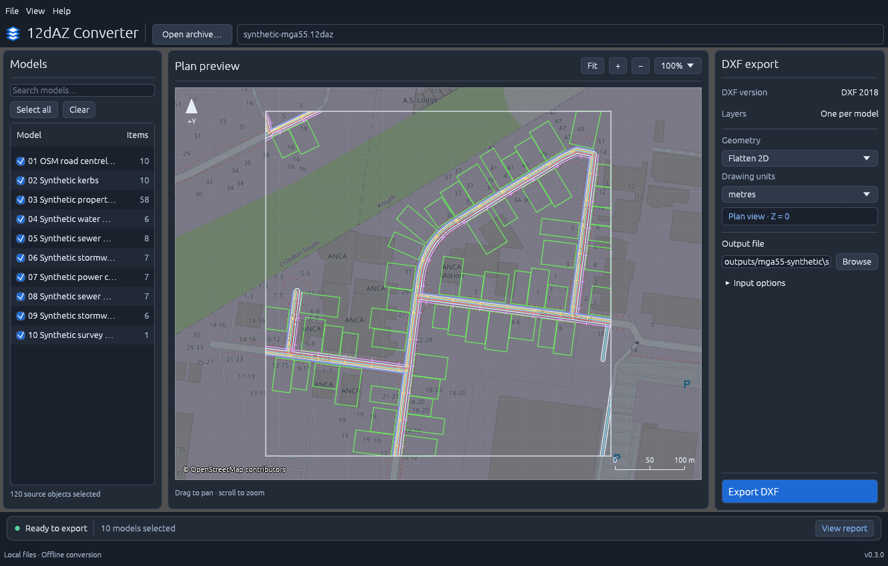

# 12dAZ Converter

Offline Windows desktop converter from **12daz / 12da to editable DXF 2018**. Export in **Flatten 2D** mode to set Z to zero, or choose **Keep Z** to retain known source elevations on supported geometry. The converter writes one layer per model and runs without 12d Model or AutoCAD installed.

**v0.4.0** adds [automatic projection suggestions](#automatic-projection-suggestions), Brisbane City Survey Grid support, and a skipped-elements preview. The Windows ZIP includes the desktop app and command-line converter. [Download v0.4.0](https://github.com/Ala-Ismail/12daz-App/releases/tag/v0.4.0) · [Road-engine validation](docs/road_boundary_engine_test_requirements.md#84-integrated-corridor-comparison)



*Synthetic MGA Zone 55 survey with the basemap at 50% opacity.* [© OpenStreetMap contributors](https://www.openstreetmap.org/copyright)

## Code signing status and Windows warning

The published v0.4.0 Windows package is unsigned. Windows may display an **Unknown publisher** notice or a Microsoft Defender SmartScreen warning. The project is preparing optional publisher signing. [Code signing policy](docs/code_signing_policy.md)

Use the project's official releases for published downloads. Verify the ZIP against its published `SHA256SUMS.txt` to check download integrity. [GitHub Releases](https://github.com/Ala-Ismail/12daz-App/releases)

## Run the Windows application

Extract the complete Windows x64 ZIP and run `12dAZ-Converter.exe` from the extracted folder. The desktop requires an OpenGL 2.0 or newer graphics driver. Keep the files in that folder together. The ZIP includes `az12-converter.exe` for command-line use.

1. Open a `.12daz` or `.12da` file.
2. Review the preview and select the models to export.
3. Choose drawing units, **Flatten 2D** or **Keep Z** under **Geometry**, and a `.dxf` destination. Declaring units does not rescale coordinates. The preview shows the source plan in either mode.
4. Select **Export DXF** and review warnings in **Report**. A `.dxf.conversion.json` report is saved beside the drawing.

**Help** provides the offline User Guide, About, license, and dependency notices. Cancel requests safe cleanup before output publication.

## Background maps

1. Open a survey and select **View → Background Map**. Choose the **Survey projection** and confirm the **Source coordinate units**. The preview supports GDA2020 and GDA94 MGA zones 46–56.
2. Use the direct grid option for surveyed coordinates already on the selected projection. For a **Local grid**, match one survey point to a known projected or WGS 84 position for translation, or add a second point for scale and rotation. Select **Apply**.
3. Select **OpenStreetMap Streets**, **Google Satellite with Labels**, or **Esri World Imagery with Labels**. OpenStreetMap requires no key. For Google or Esri, follow the setup steps in **Help → User Guide**. Enter your API key and select **Set key**. Select **Remember this key on this PC** before setting it to store it in Windows Credential Manager.
4. Adjust the map opacity to keep survey linework readable. Use **Save alignment** to store the alignment and source units beside the survey in a `.12daz-map.json` sidecar.

Maps are off by default. When enabled, the selected provider receives requests for the visible map area. The basemap serves as a visual reference in the plan preview. DXF export runs offline and preserves the source coordinates.

The map also supports **GDA94 / BCSG02 (EPSG:3113)** and **GDA2020 / BCSG2020 (EPSG:20047)**. Use **Manual grid selection** under **Projection suggestions** when you already know the grid, source units or project location. During **Compare on OpenStreetMap**, choose a road centreline model and select **Check visible road match** for an approximate score from the displayed tiles. You can also compare road and boundary models against a local OpenStreetMap GeoJSON extract. Apply the projection after confirming it.

[Website examples](https://12daz-app-website.vercel.app/#background-maps)

### Automatic projection suggestions

Select **View > Background Map > Projection suggestions > Detect MGA**. The app checks compatible grids in the background and shows up to three ranked results. It assumes metres when units are unset. Datum variants appear under the same grid.

Detect MGA uses local road vectors first. For missing coverage it sends only the candidate area bounds to OpenStreetMap Overpass. To compare offline on open, put a local WGS 84 extract beside the archive, for example `survey.12daz.osm-roads.geojson`.

The results report combined road-edge and centreline agreement. **Match** requires more than 70%. Lower positive scores are shown for review and grids without coverage remain unchecked. Select a datum and choose **Apply reviewed grid** to change the map alignment. **Help > Map Projection Suggestions** opens the offline guide at the relevant section. [Grid sweep tests](docs/mga_detection_acceptance_tests.md#10-automatic-grid-sweep) · [Road-engine validation](docs/road_boundary_engine_test_requirements.md#84-integrated-corridor-comparison)

## Run from source

Use the Rust 1.99.1 toolchain with the Windows MSVC build tools and Windows SDK. Run these commands from the repository root.

```powershell
cargo run --manifest-path rust/Cargo.toml --locked --features desktop --bin 12dAZ-Converter
```

The desktop uses `eframe`/`egui`. It runs conversion on a background worker using the same Rust service as the CLI. The core uses `acadrust` to write and reopen DXF 2018. Python's `ezdxf` remains an independent audit reader in migration tests.

**Future features and enhancements are Rust-only.** Implement them in `rust/` and add coverage to the Rust test suite. The Python source serves as the historical parity reference and supports builds from earlier release tags.

Run the CLI from the portable folder in PowerShell.

```powershell
.\az12-converter.exe inspect "survey.12daz" --report "inspect.json"
.\az12-converter.exe convert "survey.12daz" --output "survey_2D.dxf" --units metres
.\az12-converter.exe convert "survey.12daz" --output "survey_3D.dxf" --units metres --geometry-mode keep-z
```

From source, use `cargo run --manifest-path rust/Cargo.toml --locked --bin az12-converter --` followed by the CLI arguments. Repeat `--model "Model name"` to select models. Use `--overwrite` to replace existing drawing and report files, `--encoding cp1252` for a legacy file without a BOM, or `--max-expanded-mib` to change the 1024 MiB limit. Exit codes are `0` for clean completion, `2` for completion with warnings or an argument error, `1` for conversion failure, and `3` for cancellation. Warnings can identify omitted attributes or substituted styles.

## Supported geometry and limits

| Source geometry | Flatten 2D (default) | Keep Z |
| --- | --- | --- |
| 2D/3D strings, super strings and legacy polylines | Exports straight segments and supported circular segments in XY. | Preserves known XYZ on straight strings and supports circular strings at a constant elevation. |
| Point strings, standalone arcs and circles, and basic single-line world-size text | Exports supported entities in XY. | Keeps explicit source elevations. Arcs must have a constant elevation. |
| Super alignments | Exports solved horizontal lines and circular arcs. If solved vertices are absent, it can reconstruct valid straight intersection-point layouts and valid open layouts with two fixed lines and a free-radius tangent arc. | Samples supported horizontal geometry against solved vertical grades and symmetric parabolas. A usable solved vertical profile is required. |
| Drainage pipe spans | Exports one polyline per verified pipe span, retaining intermediate plan vertices. | Pending verification of the source pipe centreline elevations. |

For Keep Z, **Plan tolerance** and **Elevation tolerance** each default to **0.01 drawing units**. Set them in the GUI or with `--plan-tolerance` and `--elevation-tolerance`. Enable **Assume linear grade on arcs** (CLI: `--linear-arc-elevations`) to sample circular strings with varying elevations using the plan tolerance. The report records the assumed grade. For active transitions with supported solved line-and-arc geometry, the report identifies that the export used the solved plan. Reconstruction of the original transition spirals is pending.

**4D strings and contours are deferred.** TINs, meshes, symbols, rendered annotations and paper/screen-size text are unsupported. The report identifies skipped objects, omitted alignment labels and drainage attributes, and style substitutions. The GUI preview prioritizes bends, outlines and spatial coverage within a shared 30,000-point allowance. Export uses the selected geometry and tolerances independently of that allowance.

**View → Show skipped elements** opens a small window showing what the selected models and geometry settings would skip. Inspect the reasons and select entries to locate them on the plan where usable coordinates are available.

The reference survey produced equivalent Python and Rust reports and reopened geometry in both export modes. [Rust validation results](docs/rust_migration_validation.md)

## Test and build

```powershell
cargo test --manifest-path rust/Cargo.toml --locked --features desktop
.\scripts\build_rust_windows.ps1
.\scripts\test_rust_windows_package.ps1 -Archive .\dist\rust-candidate\12dAZ-Converter-0.4.0-Windows-x64.zip
```

The package script writes a ZIP and `SHA256SUMS.txt` to `dist/rust-candidate/`. Use `-OutputDirectory` to build into another folder and `-Offline` after the locked dependencies are cached. The package test verifies the checksum and executable metadata, opens the extracted desktop in smoke-test mode, and checks GUI/CLI parity with synthetic data.

The Python source is retained as the historical baseline. Its interpreter and test setup, the parity runner, and the separate clean-machine check are documented here. [Python baseline](docs/rust_migration_baseline.md) · [Migration tests](docs/rust_migration_test_requirements.md) · [Release validation](docs/rust_migration_validation.md)

## GitHub builds and releases

Push to `main` to build the Windows package in GitHub Actions. Download the ZIP and checksum from the successful run's **Artifacts** section.

The release workflow uses the Rust manifest where present and uses the Python build for earlier tags. For a new release, tag the reviewed source with the version in `rust/Cargo.toml` and follow the release workflow. [GitHub build and release steps](docs/github_release.md)

## Project documents

### Design and testing

- [Converter design and original GUI concept](12daz_design.md)
- Plan preview design for [background map integration](design.md#1-background-maps) and the [skipped-elements preview](design.md#2-preview-of-skipped-elements)
- [Projection suggestions and OpenStreetMap comparison](design.md#15-automatic-mga-detection-and-assignment), [Brisbane City Survey Grid](design.md#16-brisbane-city-survey-grid), and [acceptance tests](docs/mga_detection_acceptance_tests.md)
- [Candidate filters and visible road-shape checks](design.md#18-narrowing-projection-candidates-and-checking-road-shapes)
- [Brainstorming proposal for projection suggestions from road shapes](detection_enhancment.md)
- [Standalone Rust road-boundary engine, run instructions and acceptance](docs/road_boundary_engine_requirements.md)
- [Road-boundary engine test requirements](docs/road_boundary_engine_test_requirements.md)
- [Background map test requirements](docs/background_map_test_requirements.md)
- [Skipped-elements preview test requirements](docs/skipped_elements_test_requirements.md)
- [Implementation steps](docs/implementation_steps.md), [product test requirements and cases](docs/test_requirements.md), and [expanded geometry fixture](tests/fixtures/expanded_geometry.md)

### Rust migration and validation

- [Python-to-Rust migration plan](docs/rust_migration_plan.md), [migration test requirements](docs/rust_migration_test_requirements.md), and [Rust validation results](docs/rust_migration_validation.md)
- [Python parity baseline](docs/rust_migration_baseline.md), [historical v0.1.3 validation results](docs/validation_status.md), and [historical v0.1.5 GUI screenshot](website/assets/12daz-converter-gui.png)

### Releases and website

- [GitHub build and release steps](docs/github_release.md) and [code signing policy](docs/code_signing_policy.md)
- [Azure publisher signing setup](docs/code_signing.md), [SignPath setup](docs/signpath_setup.md), and [SignPath application preparation](docs/signpath_application.md)
- [Website maintenance](website/README.md) and [website design](website/website_design.md)
- [Project agent guidance](.agent)

Keep private inputs in ignored `sample/` and generated drawings and local reports in ignored `outputs/`.

## Support development

12dAZ Converter is free and open source. If you find it useful, [buy us a coffee via PayPal](https://paypal.me/12dazapp) to support ongoing development and maintenance.

The optional support link is available on the startup splash and in **Help > About**. It opens PayPal in your browser when selected.

## License

Copyright (c) 2026 Lambda Technologies Pty Ltd ABN 22 647 165 160

The project uses the [MIT License](LICENSE). Third-party dependencies retain their own licenses. The portable package includes their notices.
